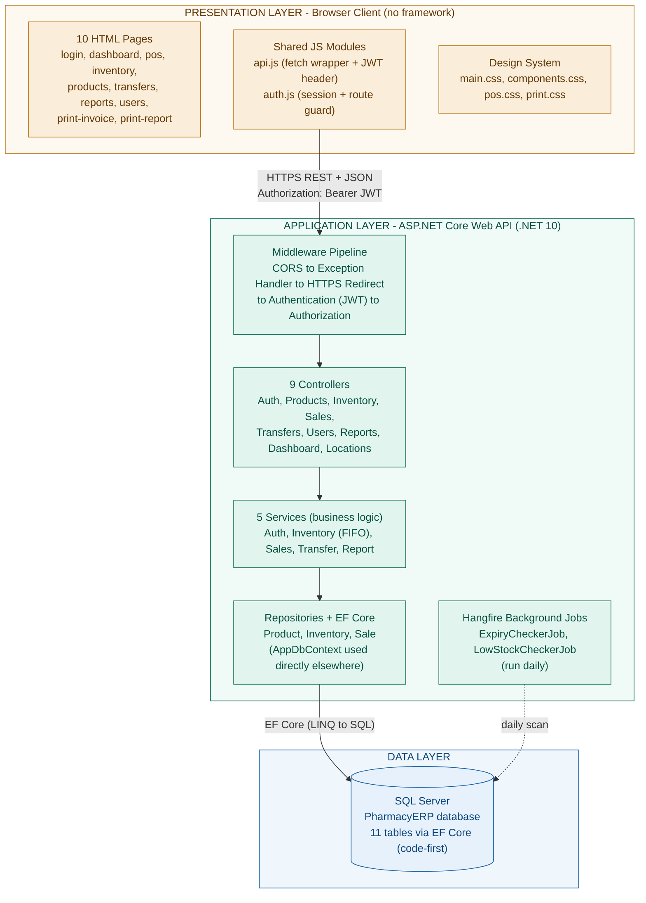
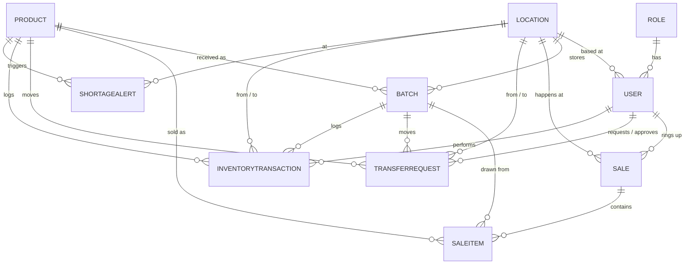
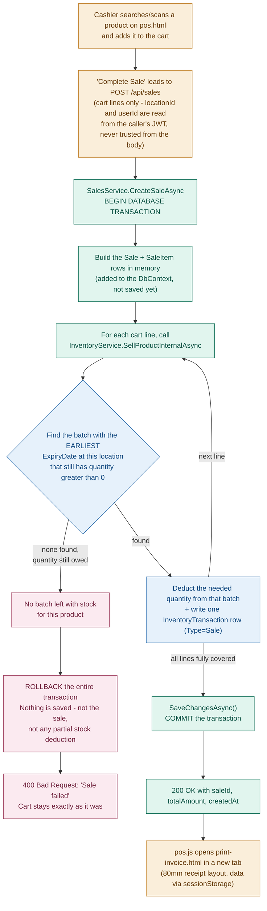
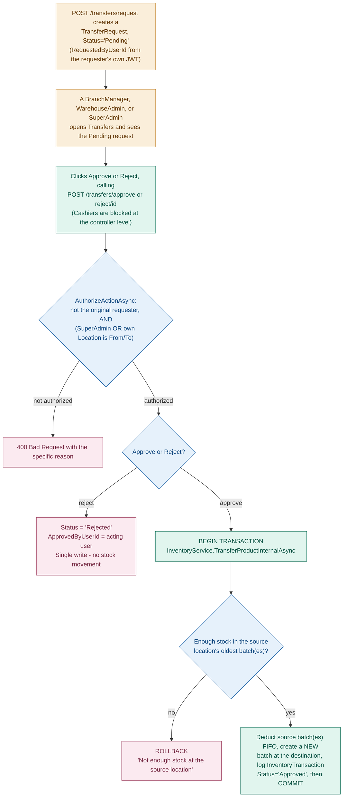

# PharmacyERP — System Architecture Document

**Multi-Branch Pharmacy Inventory, POS & Transfer Management System**

| | |
|---|---|
| **Scope** | Frontend architecture, Backend architecture, Data architecture |
| **Stack** | .NET 10 (ASP.NET Core Web API) · SQL Server / EF Core · HTML/CSS/JavaScript |
| **Source verified** | Delivered project archive (`Pharmacy_ERP.zip`) — read in full, file by file |
| **Date** | August 29, 2026 |

*Prepared with Claude, from the delivered codebase and the original project plan.*

## Contents

- [1. Purpose of This Document](#1-purpose-of-this-document)
- [2. System Overview](#2-system-overview)
- [3. Architecture Style & High-Level View](#3-architecture-style--high-level-view)
- [4. Technology Stack](#4-technology-stack)
- [5. Backend Architecture](#5-backend-architecture)
- [6. Data Architecture](#6-data-architecture)
- [7. Security Architecture](#7-security-architecture)
- [8. Frontend Architecture](#8-frontend-architecture)
- [9. Key End-to-End Flows](#9-key-end-to-end-flows)
- [10. Runtime & Deployment Topology](#10-runtime--deployment-topology)
- [Appendix A — Full Endpoint Reference](#appendix-a--full-endpoint-reference)

---

## 1. Purpose of This Document

This document describes the architecture of PharmacyERP exactly as it exists in the delivered codebase (`Pharmacy_ERP.zip`): the frontend, the backend, and the data layer, how they fit together, and the conventions used throughout. It is written to be read on its own — by a reviewer, a teammate picking up the project, or the original author returning to it after time away.

Every structural claim in this document — controller routes, role restrictions, entity fields, middleware order, package versions — was verified by reading the actual source files, not inferred from the original project plan or from naming conventions. Where the current implementation differs from what the plan called for, or where a piece is scaffolded but not yet wired up, this document says so plainly and neutrally, in the relevant section, rather than treating the codebase as finished in places where it is still in progress. A companion document, the Project Report, covers the product idea, the feature set, and the development status against the original plan; this document stays focused on structure.

## 2. System Overview

PharmacyERP is a multi-branch pharmacy management system built around one shared reality: a chain of pharmacy branches and a central warehouse need to see and move stock across locations, sell it at the counter, and keep expired or short-dated medicine out of what customers are sold — rather than each branch running its own disconnected spreadsheet or till.

The system is organized around four ideas that shape almost every other design decision in the codebase:

- **Stock lives in batches, not just quantities.** Every unit of stock is received as a Batch with its own expiry date, and the system always sells or transfers the oldest-expiring batch first (FIFO by expiry) — not the oldest by arrival date.
- **Stock is location-scoped.** The same Product can have separate batches sitting at the warehouse and at each branch simultaneously; moving stock between them is a first-class, auditable operation (a Transfer Request), not a manual adjustment.
- **Every write that changes stock is logged.** Sales and approved transfers both write an `InventoryTransaction` row alongside the change itself, so there is, in principle, a full trail of where every unit went.
- **Access is role- and location-aware.** Four roles (SuperAdmin, BranchManager, Cashier, WarehouseAdmin) see the same screens but different data and different actions, enforced on the server, not just hidden in the UI.

> **At a glance**
> 1 central warehouse + N branches, modeled uniformly as "Locations." 9 REST controllers, 5 business-logic services, 11 database tables. 10 frontend pages, no build step, no UI framework — plain HTML/CSS/JavaScript. 2 scheduled background jobs (expiring stock, low stock) running once a day.

## 3. Architecture Style & High-Level View

PharmacyERP is a classic three-tier, client-server web application:

1. **A presentation layer** — static HTML/CSS/JavaScript served to the browser, with no server-side rendering and no SPA framework. Every page talks to the API exclusively over HTTP as JSON.
2. **An application layer** — a single stateless ASP.NET Core Web API project ("Pharmacy API") that owns all business logic and all data access.
3. **A data layer** — one SQL Server database ("PharmacyERP"), accessed exclusively through Entity Framework Core; nothing in the frontend talks to the database directly.

The API is stateless: each request carries its own credentials as a JSON Web Token in the Authorization header, so any request can, in principle, be served by any running instance of the API with no server-side session to keep in sync. The frontend and backend are two separate deployables that only ever communicate over HTTP — there is no shared process or shared memory between them.


*Figure 1 — High-level, three-tier view of PharmacyERP.*

Within the application layer, requests flow strictly downward through four sub-layers — Controllers, Services, Repositories, and the EF Core DbContext — described in detail in Section 5. A separate, parallel path (Hangfire background jobs) reaches into the same services once a day on a timer rather than in response to an HTTP request.

## 4. Technology Stack

| Layer | Technology | Role in the system |
|---|---|---|
| Frontend | HTML5 · CSS3 · vanilla JavaScript (ES6+) | 10 static pages; no bundler, no build step, no framework (no React/Vue/Bootstrap) |
| Frontend | Tabler Icons · Google Fonts (Cairo, Inter) | Iconography and typography, both loaded from CDN |
| Backend | ASP.NET Core Web API — .NET 10 | REST API host, project targets `net10.0` |
| Backend | Entity Framework Core 10 (SQL Server provider) | Code-first ORM; no explicit `OnModelCreating` configuration |
| Backend | JWT Bearer Authentication | Stateless auth; HMAC-SHA256-signed tokens, 8-hour expiry |
| Backend | BCrypt.Net-Next 4.2.0 | Password hashing for stored `User.PasswordHash` |
| Backend | AutoMapper 16.1.1 | Registered in DI; a mapping profile exists but is not currently called from any controller or service |
| Backend | Hangfire 1.8.23 (+ SQL Server storage) | Runs the two daily background jobs; dashboard at `/hangfire` |
| Backend | Swashbuckle.AspNetCore 10.2.3 (Swagger) | Interactive API docs, Development environment only |
| Backend | Serilog.AspNetCore 10.0.0 | Referenced in the project file but not configured in `Program.cs` — the app currently logs through the built-in ASP.NET Core provider instead |
| Data | Microsoft SQL Server | System of record — "PharmacyERP" database, 11 tables, one per entity |

Two entries above are worth calling out explicitly because the package name alone would suggest otherwise: **Serilog is installed but never initialized**, and **AutoMapper is wired into the dependency-injection container but never invoked** — every controller currently maps between models and responses by hand. Neither is a defect so much as unfinished wiring; both are flagged again where relevant in [§5.7](#57-cross-cutting-concerns).

## 5. Backend Architecture

### 5.1 Layering & Request Flow

The backend follows a conventional layered architecture. A request enters through a Controller, which delegates business logic to a Service, which in turn reads and writes data either through a Repository or, in several places, directly through the shared `AppDbContext`:

```
Controller  →  Service  →  Repository (or AppDbContext directly)  →  SQL Server
```

This pattern is consistent for the three busiest, most logic-heavy areas of the system — products, inventory, and sales — each of which has a dedicated repository interface and implementation. It is **not** applied uniformly across the whole project: `LocationsController`, `UsersController`, `DashboardController`, and the read side of `TransfersController` query `AppDbContext` directly instead of going through a repository. This is a real inconsistency in the layering, not a bug — all of it still works correctly — but it means "add a repository method" and "query the DbContext inline" are both live patterns in the same codebase depending which controller you're reading.

All controllers, services, and repositories are registered with a **Scoped** lifetime, meaning a new instance of each is created per HTTP request and shared by everything that request touches — including the single `AppDbContext` instance, which is what allows a Service to open one database transaction and have every repository call within that request participate in it.

### 5.2 Middleware Pipeline

`Program.cs` wires the ASP.NET Core middleware pipeline in this exact order:

```
1. UseCors("AllowAll")
2. UseMiddleware<ExceptionHandlerMiddleware>()
3. UseHttpsRedirection()
4. UseAuthentication()
5. UseAuthorization()
6. UseHangfireDashboard("/hangfire")
```

The order matters. CORS is evaluated first so that cross-origin preflight requests from the frontend succeed before anything else runs. The custom exception handler sits immediately after, wrapping every later stage — including authentication and authorization — so that an unhandled exception anywhere downstream still comes back to the client as the same consistent JSON error shape rather than a raw stack trace. Authentication runs before authorization by necessity: the pipeline has to establish who the caller is (by validating the JWT) before `UseAuthorization` can decide what that caller is allowed to do.

> **ExceptionHandlerMiddleware** — A single try/catch wrapped around the rest of the pipeline. Any unhandled exception is caught, logged, and turned into a uniform JSON error response instead of the ASP.NET Core default developer exception page (in Development) or a bare 500 (in Production). This is the only custom middleware in the project.

### 5.3 Controllers

Nine controllers expose the API, each mapped to `api/[controller]` by convention. All but two (Auth and Users) carry a class-level `[Authorize]` attribute, meaning every action requires a valid JWT unless the action itself is separately marked; role restrictions beyond "logged in" are applied per action, shown in the last column below.

| Controller | Base route | Class-level auth | Notable role restrictions |
|---|---|---|---|
| `AuthController` | `api/auth` | None | `POST /login` — the only endpoint; issues the JWT |
| `DashboardController` | `api/dashboard` | Any logged-in user | Stats are scoped to the caller's own location unless the caller is SuperAdmin |
| `LocationsController` | `api/locations` | Any logged-in user | Read-only — no create, update, or delete endpoint exists for locations |
| `ProductsController` | `api/products` | Any logged-in user | Create / Update / Delete → SuperAdmin, BranchManager |
| `InventoryController` | `api/inventory` | Any logged-in user | AddBatch (receive stock) → SuperAdmin, WarehouseAdmin |
| `SalesController` | `api/sales` | Any logged-in user | CreateSale (checkout) → SuperAdmin, BranchManager, Cashier |
| `TransfersController` | `api/transfers` | Any logged-in user | RequestTransfer → any logged-in role. Approve / Reject → SuperAdmin, BranchManager, WarehouseAdmin only |
| `ReportsController` | `api/reports` | Any logged-in user | No additional role gate on any of its 3 endpoints (see [§6.4](#64-schema-provisioning--current-state) and [§7.3](#73-location-scoped-data-isolation)) |
| `UsersController` | `api/users` | None at class level | GetAll / GetById / Update / Delete → SuperAdmin only. Create has no `[Authorize]` at all (see [§7.5](#75-current-security-posture--notes-for-hardening)) |

### 5.4 Services

Business logic is concentrated in five services, each injected into the controllers that need it:

| Service | Responsibility |
|---|---|
| `AuthService` | Verifies email + password against the stored BCrypt hash; issues the signed JWT with four claims (see §7.1). |
| `InventoryService` | Stock lookups by location/product; the FIFO batch-selection logic used internally to fulfil both sales and transfers; adding new stock batches. |
| `SalesService` | Orchestrates a checkout as a single database transaction — builds the Sale and SaleItem rows, calls InventoryService once per cart line, and commits only if every line is fully covered. |
| `TransferService` | The request → approve/reject workflow for moving stock between locations, including the self-approval and location-based authorization checks (§9.3). |
| `ReportService` | Expiring-batch and shortage-alert queries (with an optional location filter), plus the shortage-alert creation logic used by the daily background job. |

### 5.5 Repositories

Three entities — Product, Inventory (Batch), and Sale — have a dedicated repository: an interface (`IProductRepository`, `IInventoryRepository`, `ISaleRepository`) plus a concrete EF Core implementation, registered as Scoped services. Each repository exposes the CRUD and lookup methods its service actually needs (for example, `IInventoryRepository` exposes the "oldest batch with stock remaining" query that the FIFO logic depends on) rather than a generic repository interface.

Location, User, and TransferRequest do **not** have a repository; `LocationsController`, `UsersController`, `DashboardController`, and the read side of `TransfersController` query `AppDbContext` directly instead. Functionally this makes no difference to correctness, but it is the clearest structural inconsistency in the backend — worth knowing about before extending either pattern further.

### 5.6 Background Jobs

Hangfire runs two recurring jobs, both registered in `Program.cs` with a daily schedule (`Cron.Daily`) and both using SQL Server as the job-storage backend (the same `DefaultConnection` as the application data):

| Job | Hangfire ID | What it actually does |
|---|---|---|
| `ExpiryCheckerJob` | `expiry-checker` | Calls `ReportService.GetExpiringBatchesAsync(90)`. The job's own code comment notes this currently only executes the query — the result isn't emailed, logged, or persisted anywhere, so today the job has no observable effect. It is the natural hook point for a future notification feature. |
| `LowStockCheckerJob` | `lowstock-checker` | Calls `ReportService.CheckAndCreateShortageAlertsAsync()`, which scans every product × location combination and creates a `ShortageAlert` row wherever quantity has fallen to or below `MinStock`, skipping products that already have an open (unresolved) alert to avoid duplicates. |

Both jobs use Hangfire's `[AutomaticRetry(Attempts = 3)]` attribute, so a transient failure (e.g. a momentarily unreachable database) is retried automatically before being marked failed. The Hangfire dashboard at `/hangfire` has no authorization filter attached in the current registration — fine on a local developer machine, but it would need one (Hangfire supports a `DashboardOptions.Authorization` filter for exactly this) before the API is exposed anywhere shared.

### 5.7 Cross-Cutting Concerns

- **DTOs:** a DTOs folder defines request/response shapes for Auth, Products, Inventory, Sales, Transfers, Reports, and Users. In practice, only `CreateUserDto` and `UpdateUserDto` are actually bound by a controller today; `ProductsController` binds the `Product` entity directly, and `SalesController` / `TransfersController` each define their own inline request classes (`CreateSaleRequest`, `SaleItemRequest`, `TransferRequestBody`) at the bottom of the controller file that duplicate fields already described by the unused DTOs. Functionally harmless, but it's duplicate shape-definition worth consolidating.
- **AutoMapper:** registered in `Program.cs` (`AddAutoMapper(typeof(Program))`) with a `MappingProfile` defining two mappings. No controller or service currently calls `IMapper.Map<>()` — all model ↔ response shaping is done by hand.
- **JSON serialization:** configured with `ReferenceHandler.IgnoreCycles`, which prevents serialization errors from EF Core's bidirectional navigation properties (e.g. Role ↔ User) without needing `[JsonIgnore]` on every back-reference.
- **Logging:** the built-in ASP.NET Core logging provider, configured via the "Logging" section of `appsettings.json`. Serilog is present in the project file but not initialized, so it currently has no effect.

## 6. Data Architecture

### 6.1 Entity-Relationship Overview

The schema has 11 entities. Every one of them carries the same three housekeeping fields — `IsDeleted`, `CreatedAt`, `UpdatedAt` — giving the whole schema a consistent soft-delete and audit-timestamp convention: nothing is ever hard-deleted from the database, and every row records when it was created and last touched.


*Figure 2 — Entity relationships (every edge is one-to-many, parent → child). `Supplier` is fully modeled but not yet connected to any other table, so it has no relationship to show here — see §6.2.*

Location and Product are the two hub entities: nearly every other table hangs off one or both of them (a Batch belongs to exactly one Product at exactly one Location; a Sale happens at one Location; a TransferRequest connects two Locations). Role and User sit in their own small identity cluster, referenced by `RoleId` and `LocationId` respectively from User, and then by `UserId` from every action a user performs (Sale, TransferRequest, InventoryTransaction).

### 6.2 Entity Reference

The table below lists every entity with its distinguishing fields (the shared `IsDeleted` / `CreatedAt` / `UpdatedAt` trio is omitted from each row for brevity, since it's identical on all eleven) and a one-line note on its current role in the system.

| Entity | Key fields (beyond Id) | Notes |
|---|---|---|
| Location | Name, Type ("warehouse"/"branch"), Address | The warehouse + branches. Type is a free-text convention, not a database-enforced enum. |
| Role | Name | Fixed, seeded set of 4 (SuperAdmin, BranchManager, Cashier, WarehouseAdmin). No CRUD endpoint — IDs are hardcoded in the frontend. |
| User | Name, Email, PasswordHash, RoleId, LocationId | One user belongs to exactly one location and one role. |
| Product | Name, Barcode, Category, Unit, MinStock, SellPrice, BuyPrice | The catalog item. Stock itself lives on Batch, not here. |
| Batch | ProductId, LocationId, BatchNumber, ExpiryDate, Quantity, Cost | A specific received lot of a product at a specific location — the unit that FIFO logic operates on. |
| Sale | LocationId, UserId, TotalAmount | One POS transaction / receipt header. |
| SaleItem | SaleId, ProductId, BatchId, Quantity, UnitPrice | One line item on a sale, tied to the exact batch it was drawn from. |
| TransferRequest | FromLocationId, ToLocationId, ProductId, BatchId, Quantity, Status, RequestedByUserId, ApprovedByUserId | One inter-location stock movement request and its approval lifecycle (Pending / Approved / Rejected). |
| InventoryTransaction | ProductId, BatchId, FromLocationId, ToLocationId, Quantity, Type, ReferenceId, UserId | An append-only log entry written by every sale and every approved transfer. Currently write-only — nothing reads it back yet. |
| ShortageAlert | ProductId, LocationId, CurrentQuantity, MinStock, IsResolved | Created by the daily low-stock job. `IsResolved` exists and is checked to avoid duplicate alerts, but nothing currently sets it back to true, so alerts accumulate even after restocking. |
| Supplier | Name, Contact, Notes | Fully modeled as an entity, but has no controller, no service, and no frontend page — not yet connected to the rest of the system. |

### 6.3 Data Conventions

- **Soft delete everywhere.** Deleting a Product, User, or any other entity sets `IsDeleted = true` rather than removing the row; every read query in the repositories and services filters on `!IsDeleted`.
- **FIFO is application logic, not a database feature.** "Sell the oldest-expiring batch first" is implemented as an `ORDER BY ExpiryDate` query inside `InventoryService`, executed inside the same transaction as the rest of the sale — the database itself has no concept of FIFO.
- **Multi-step writes are wrapped in explicit transactions.** A sale is "insert Sale + insert SaleItem(s) + decrement Batch quantity/quantities + insert InventoryTransaction row(s)" as one all-or-nothing unit, and the same is true for an approved transfer. If any step fails, the whole operation rolls back — there is no code path that leaves stock partially deducted.
- **No enums for status/type fields.** `Location.Type`, `TransferRequest.Status`, and `InventoryTransaction.Type` are all plain strings rather than a C# enum or a database CHECK constraint; valid values are a convention enforced by the code that writes them, not by the schema.

### 6.4 Schema Provisioning — Current State

> **No migrations or SQL scripts are included in the delivered project.**
> There is no EF Core Migrations folder and no `.sql` file anywhere in the archive, so "create the database" is not currently a one-command step — the schema only comes into existence via EF Core's own conventions when the app first connects (e.g. through `EnsureCreated`, or migrations added later).
>
> The `Location` and `Role` model files document the seed data the application expects to already exist — 4 Locations (Central Warehouse plus 3 branches) and the 4 fixed Roles — but no seeding code, script, or migration currently inserts those rows anywhere in the project.
>
> **Practical effect:** a fresh copy of this project cannot be logged into or used out of the box today. Someone has to create the schema and insert at least the Role and Location rows (and one initial User, since `UsersController`'s Create endpoint is how a user is normally added) before the login screen has anything to authenticate against.

This is a data-architecture fact worth stating plainly here because it affects anyone standing the project up from scratch; it's discussed again from a "what to do about it" angle in the companion Project Report.

Separately, because there is no `OnModelCreating` override in `AppDbContext`, EF Core falls back to its default conventions for column types — in particular, every decimal property (`Batch.Cost`, `Product.SellPrice`/`BuyPrice`, `Sale.TotalAmount`, `SaleItem.UnitPrice`) maps to `decimal(18,2)` without that precision being stated explicitly in code, which EF Core surfaces as a startup warning. It works correctly as-is; making the precision explicit would just silence the warning.

## 7. Security Architecture

### 7.1 Authentication

Login is a single endpoint, `POST /api/auth/login`, which checks the submitted email/password against the stored BCrypt hash and, on success, issues a JSON Web Token signed with HMAC-SHA256. The token carries four claims and expires 8 hours after issue:

```
ClaimTypes.NameIdentifier → User.Id
ClaimTypes.Email          → User.Email
ClaimTypes.Role           → Role.Name  (e.g. "BranchManager")
"LocationId"              → User.LocationId
```

Every subsequent request authenticates by sending this token in an `Authorization: Bearer <token>` header. Token validation (configured in `Program.cs`) checks the signature and expiry (`ValidateLifetime = true`, `ValidateIssuerSigningKey = true`) but does not check an issuer or audience (`ValidateIssuer = false`, `ValidateAudience = false`) — a reasonable simplification for a single, self-contained API that doesn't need to distinguish tokens meant for other services, though it's worth revisiting if the API ever sits behind a shared identity provider.

### 7.2 Authorization — Role Permission Matrix

Four roles exist: SuperAdmin, BranchManager, Cashier, and WarehouseAdmin. Every protected endpoint is guarded by ASP.NET Core's `[Authorize]` attribute, either at the controller level ("must be logged in") or at the action level with a Roles list ("must be logged in as one of these roles"). The matrix below summarizes who can do what, drawn directly from the `[Authorize(Roles = …)]` attributes in each controller:

| Action | SuperAdmin | BranchManager | Cashier | WarehouseAdmin |
|---|:---:|:---:|:---:|:---:|
| View dashboard / own location's data | ✓ | ✓ | ✓ | ✓ |
| Sell at POS (create a sale) | ✓ | ✓ | ✓ | – |
| Create / edit / delete products | ✓ | ✓ | – | – |
| Receive stock (add a batch) | ✓ | – | – | ✓ |
| Request a stock transfer | ✓ | ✓ | ✓ | ✓ |
| Approve / reject a transfer | ✓ | ✓ | – | ✓ |
| Manage users | ✓ | – | – | – |

Reports (expiring stock, shortage alerts) are readable by any logged-in role today, which is a location-scoping gap rather than a role gap — covered next.

### 7.3 Location-Scoped Data Isolation

Beyond role, several endpoints are meant to further scope data to the caller's own branch unless they're a SuperAdmin (who can see everything). This pattern is implemented consistently in two places and not yet applied in a third:

- **`DashboardController`** reads the caller's `LocationId` claim and passes it through, so a BranchManager or Cashier only ever sees their own branch's stats; a SuperAdmin sees company-wide figures.
- **`TransferService`'s approval/rejection logic** checks that the acting user is either a SuperAdmin or based at the transfer's From or To location before allowing an approve/reject action — and separately blocks a user from approving their own request, regardless of role.
- **`ReportsController`** does not currently pass a location filter through, even though `ReportService.GetExpiringBatchesAsync` and `GetShortageAlertsAsync` both accept an optional `locationId` parameter for exactly this purpose. In the current build, `GET /api/reports/expiring` and `GET /api/reports/shortages` return company-wide data to any logged-in user, including a Cashier at a single branch. This is the one place the "scope to caller's location unless SuperAdmin" pattern used elsewhere in the app hasn't been carried through — the fix is mechanical (read the `LocationId` claim in `ReportsController` the same way `DashboardController` already does, and pass it to the two service calls) but it hasn't been made yet.

### 7.4 Password Handling

Passwords are never stored in plain text. `AuthService` hashes them with BCrypt.Net-Next on the way in and verifies with `BCrypt.Verify` on login; BCrypt's salting is automatic and per-password, so two users with the same password get different stored hashes.

### 7.5 Current Security Posture — Notes for Hardening

The items below are all reasonable for a project running locally during development, and none of them affects correctness — the system behaves as designed. They're listed here as an explicit, honest inventory of what to revisit before any deployment beyond a single developer's machine, which is standard practice for any project at this stage:

- **CORS policy "AllowAll"** accepts any origin, method, and header. Fine for local development against localhost; should be narrowed to the actual frontend origin(s) before any shared deployment.
- **The JWT signing key lives in `appsettings.json`** as plain configuration (with a hardcoded fallback in `Program.cs` if the config value is missing). `appsettings.Example.json` exists as a template for keeping real secrets out of source control, but the working `appsettings.json` with a real-looking key is present in the delivered archive. Standard practice before deployment is moving this to an environment variable, user-secrets store, or a secrets manager.
- **`UsersController.Create` has no `[Authorize]` attribute at all**, by design — it's how the very first SuperAdmin account gets created, since there's no way to log in and create a user before any user exists. The code comment in the file flags this explicitly as intentional but notes there's currently no mechanism to close the endpoint again afterward, so anyone who can reach the API can call it to create additional accounts (including SuperAdmin ones) indefinitely.
- **The Hangfire dashboard at `/hangfire`** has no authorization filter attached, so anyone who can reach the API can view job history and trigger jobs manually.
- **Frontend role-gating (hiding the Users nav link, etc.) is presentation only.** This is not a security gap by itself — every one of those actions is independently enforced server-side by the `[Authorize(Roles=…)]` attributes in §7.2 — but it's worth being explicit that the UI hiding buttons is a convenience, not the actual access-control boundary.

## 8. Frontend Architecture

### 8.1 Page Inventory

Ten static HTML pages make up the entire client. There is no router, no bundler, and no shared layout templating — each page is a self-contained HTML file that includes the shared CSS and JS files it needs via plain `<link>` and `<script>` tags.

| Page | Purpose | Intended audience |
|---|---|---|
| `login.html` | Authenticates and stores the JWT + decoded user | Public |
| `dashboard.html` | Landing page after login — KPI stat cards + recent activity tables | Any role |
| `pos.html` | Point of sale: product search/barcode entry, cart, checkout | SuperAdmin, BranchManager, Cashier |
| `inventory.html` | Stock levels by location/product; receive new batches | Any role (AddBatch restricted server-side) |
| `products.html` | Product catalog CRUD | Any role (write restricted server-side) |
| `transfers.html` | Create, view, approve, and reject transfer requests | Any role (approve/reject restricted server-side) |
| `reports.html` | Expiring-stock and shortage-alert views | Any role |
| `users.html` | User management (SuperAdmin only in practice) | SuperAdmin |
| `print-invoice.html` | 80mm-width printable receipt, opened from pos.html | Reached only via POS checkout |
| `print-report.html` | A4 printable report, opened from reports.html | Reached only via Reports |

"Intended audience" above describes the UI's own gating (which nav links and buttons a role sees), not a hard access boundary — the real boundary is the server-side `[Authorize]` attributes covered in §7.2.

### 8.2 Shared Modules

- **`api.js`** — a thin `fetch()` wrapper, one function group per backend controller, that automatically attaches the stored JWT as an `Authorization` header and centralizes error handling for non-2xx responses. Every page's own script calls into this module rather than calling `fetch()` directly.
- **`auth.js`** — owns the browser-side session: storing the JWT and the decoded user object (id, name, email, role, locationId) in `localStorage` after login, exposing a `require()` guard that every protected page calls on load to redirect back to `login.html` if no valid session is present, and clearing storage on logout.

Because the client-side guard only checks "is a token present," it is a UX convenience (don't show a protected page to a logged-out visitor) rather than a security boundary — the same point made in §7.5 about role-gating applies here too.

### 8.3 Design System

The visual design lives in four hand-written CSS files rather than a component framework: `main.css` defines the design tokens (a "Clinical Blue" color palette as CSS custom properties, spacing scale, typography using Cairo for headings and Inter for body text) and the base layout/navigation; `components.css` styles shared widgets (buttons, cards, modals, badges, tables, form controls) built from those tokens; `pos.css` and `print.css` hold layout rules specific to the point-of-sale screen and the two print pages respectively. No CSS framework (Bootstrap, Tailwind, etc.) is used anywhere — every rule is original to this project.

### 8.4 State Management

There is no client-side state management library. Each page keeps its own working data (the current cart on `pos.html`, the currently loaded product/stock list, etc.) in plain JavaScript variables scoped to that page's script file, re-fetched from the API on load and updated in place after each action. The only state that persists across page loads is the session (JWT + user object) in `localStorage`; everything else is rebuilt from the server every time a page is opened.

## 9. Key End-to-End Flows

### 9.1 Login

1. `login.html` submits email + password to `POST /api/auth/login`.
2. `AuthService` looks up the user by email, verifies the password against the BCrypt hash, and — if it matches — issues a signed JWT.
3. `auth.js` decodes the token client-side (no server round-trip needed) to build the displayed user object, stores both the raw token and that object in `localStorage`, and redirects to `dashboard.html`.
4. Every later page load calls `auth.require()`, which simply checks that a token is present; every later API call goes through `api.js`, which attaches it as a Bearer header automatically.

### 9.2 Sale (POS Checkout) — FIFO in Action

This is the flow where the FIFO batch logic and the transactional-integrity guarantee described in §6.3 are most visible end to end:


*Figure 3 — POS checkout, from cart to printed receipt, including the FIFO batch-selection loop and the all-or-nothing failure path.*

The key guarantee this flow provides: `locationId` and `userId` are read from the cashier's own JWT, never accepted from the request body, so a sale can't be recorded against a different branch or a different cashier than the one actually logged in. And because the whole operation is one database transaction, a cart with five items where the fifth item is out of stock results in nothing being saved — not the sale, not the first four items' stock deductions — rather than a partially-completed sale.

### 9.3 Transfer Request → Approval

Moving stock between the warehouse and a branch (or between two branches) is a two-step, two-party workflow rather than a direct edit, so that one person requesting stock can't also be the one approving its release:


*Figure 4 — Transfer request and approval, including the authorization check and the stock-movement transaction.*

Approving a transfer performs the same kind of FIFO deduction as a sale (oldest-expiry batch at the source location first), but instead of reducing stock to zero it creates a new Batch row at the destination location, preserving the original expiry date on the moved stock. Rejecting a transfer is a single status write with no stock movement at all.

### 9.4 Background Job Cycle

Independently of any user action, Hangfire wakes both jobs once a day (`Cron.Daily`). `LowStockCheckerJob` has a real, visible effect: it scans every product at every location and inserts a `ShortageAlert` row wherever quantity has dropped to or below that product's `MinStock` (skipping products that already have an unresolved alert open). `ExpiryCheckerJob` currently runs its query — fetching batches expiring within 90 days — and discards the result; the query executes successfully every day, but nothing downstream (no email, no log entry, no stored record) currently consumes it.

## 10. Runtime & Deployment Topology

The project currently targets a single developer machine running the API and the database locally, with the frontend served as static files:

| Component | Address | Notes |
|---|---|---|
| API (HTTP) | `http://localhost:5277` | `launchSettings.json` "http" profile |
| API (HTTPS) | `https://localhost:7104` | `launchSettings.json` "https" profile (also opens 5277) |
| Swagger UI | `/swagger` | Development environment only |
| Hangfire dashboard | `/hangfire` | No authorization filter attached (see §7.5) |
| Database | SQL Server, "DefaultConnection" in `appsettings.json` | Shared by EF Core and Hangfire's job storage |

One inconsistency worth flagging here: `api.js`'s own header comment documents the API root as `https://localhost:7104/api`, but the ACTUAL constant in the code (`API_BASE`) is set to `http://localhost:5277/api`. Since `Program.cs` also calls `UseHttpsRedirection()`, a request to the HTTP port can be redirected to HTTPS depending on how the API is launched — worth confirming which port the frontend is meant to call and keeping the comment, the constant, and the redirect behavior in agreement.

The frontend has no server of its own in this delivery — the HTML/CSS/JS files are opened directly or served by any static file host pointed at the project root; there is no separate "frontend build" step to run.

## Appendix A — Full Endpoint Reference

Every route in the API, grouped by controller, with its HTTP method and the minimum role required to call it ("Any" means any authenticated user regardless of role).

| Method | Route | Minimum role |
|---|---|---|
| POST | `/api/auth/login` | Public |
| GET | `/api/dashboard` | Any (location-scoped unless SuperAdmin) |
| GET | `/api/locations` | Any |
| GET | `/api/products` | Any |
| GET | `/api/products/{id}` | Any |
| GET | `/api/products/barcode/{barcode}` | Any |
| POST | `/api/products` | SuperAdmin, BranchManager |
| PUT | `/api/products/{id}` | SuperAdmin, BranchManager |
| DELETE | `/api/products/{id}` | SuperAdmin, BranchManager |
| GET | `/api/inventory/location/{locationId}` | Any |
| GET | `/api/inventory/product/{productId}` | Any |
| GET | `/api/inventory/stock/{productId}/{locationId}` | Any |
| POST | `/api/inventory/batch` | SuperAdmin, WarehouseAdmin |
| GET | `/api/sales` | Any |
| GET | `/api/sales/location/{locationId}` | Any |
| GET | `/api/sales/{id}` | Any |
| POST | `/api/sales` | SuperAdmin, BranchManager, Cashier |
| GET | `/api/transfers` | Any |
| POST | `/api/transfers/request` | Any |
| POST | `/api/transfers/approve/{transferId}` | SuperAdmin, BranchManager, WarehouseAdmin* |
| POST | `/api/transfers/reject/{transferId}` | SuperAdmin, BranchManager, WarehouseAdmin* |
| GET | `/api/reports/expiring?days=90` | Any (not location-scoped — §7.3) |
| GET | `/api/reports/shortages` | Any (not location-scoped — §7.3) |
| POST | `/api/reports/check-shortages` | Any |
| GET | `/api/users` | SuperAdmin |
| GET | `/api/users/{id}` | SuperAdmin |
| POST | `/api/users` | None — open endpoint (§7.5) |
| PUT | `/api/users/{id}` | SuperAdmin |
| DELETE | `/api/users/{id}` | SuperAdmin |

\* Approve/Reject additionally require, at the service layer, that the acting user is not the original requester and is either SuperAdmin or based at the source or destination location (§9.3).
