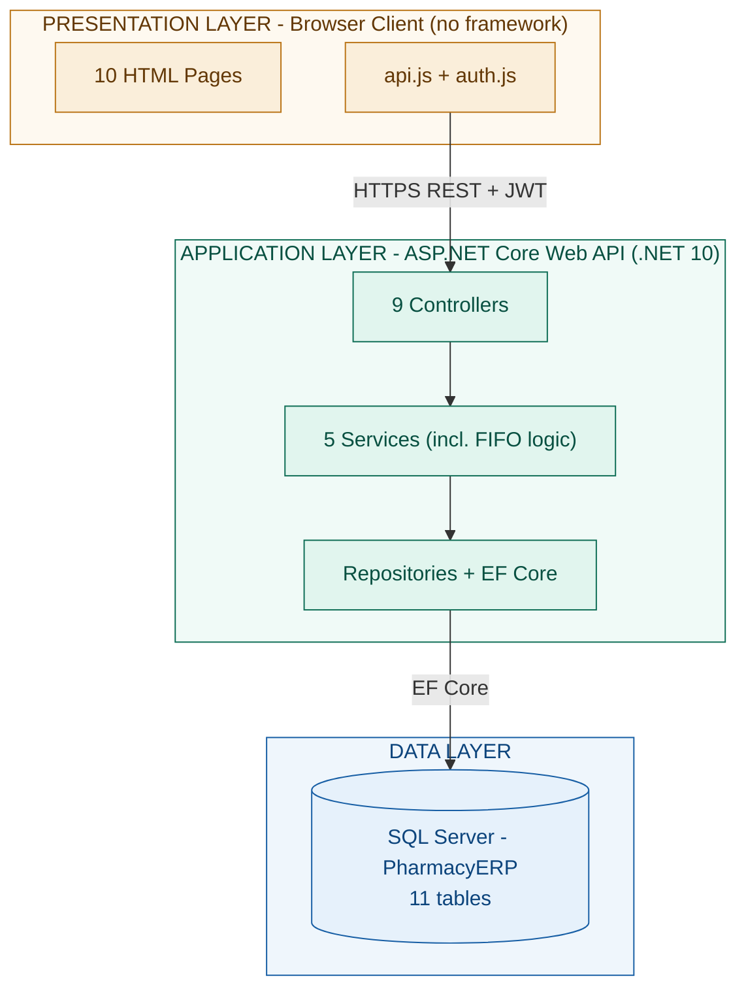

# PharmacyERP — Full Project Report

**Idea, Features, Implementation & Current Status**

| | |
|---|---|
| **Companion document** | `Pharmacy_ERP_Architecture.md` (structural / technical detail) |
| **Based on** | The delivered project archive + the original 5-phase project plan |
| **Date** | August 29, 2026 |

*Prepared with Claude, from the delivered codebase and the original project plan.*

## Contents

- [1. Executive Summary](#1-executive-summary)
- [2. Problem Statement & Motivation](#2-problem-statement--motivation)
- [3. Objectives](#3-objectives)
- [4. Scope](#4-scope)
- [5. Users & Roles](#5-users--roles)
- [6. Feature Walkthrough](#6-feature-walkthrough)
- [7. System Architecture Summary](#7-system-architecture-summary)
- [8. Technology Stack Summary](#8-technology-stack-summary)
- [9. Core Business Logic, Explained](#9-core-business-logic-explained)
- [10. Development Methodology](#10-development-methodology)
- [11. Implementation Status vs. the Original Plan](#11-implementation-status-vs-the-original-plan)
- [12. Known Limitations & Recommendations](#12-known-limitations--recommendations)
- [13. Conclusion](#13-conclusion)

---

## 1. Executive Summary

PharmacyERP is a working, end-to-end management system for a pharmacy chain: one central warehouse and several branches, sharing a single product catalog while keeping stock, sales, and staff scoped to their own location. A cashier can ring up a sale at the counter; a warehouse admin can receive new stock; a branch manager can request or approve stock moving in from the warehouse; and a super admin can see and manage all of it. Underneath the screens, the system always sells and moves the soonest-to-expire stock first, and it keeps sales and transfers atomic — either an entire operation succeeds, or none of it does.

The project was built in five phases — database, backend, frontend, security, and a final "extras" phase — and delivers substantially on the first four. The core loop (log in → sell/receive/transfer stock → see it reflected everywhere) works correctly end to end. What remains is mostly what the plan itself labeled as extras (real-time updates, exported reports, offline support, containerized deployment, automated tests) plus a short list of concrete, well-understood gaps — detailed in Sections 11 and 12 — that stand between this build and a production launch.

> **How to read this report** — This document covers the product: what it does, who it's for, and how completely it was built relative to the original plan. For how it's built — the exact controllers, database schema, request flows, and security mechanics — see the companion Architecture document.

## 2. Problem Statement & Motivation

A pharmacy chain running a warehouse plus several branches has a coordination problem that a single-till, single-location point-of-sale system doesn't solve. Three pressures in particular motivate this project:

- **Medicine expires.** Unlike most retail stock, pharmacy inventory has a hard, safety-relevant expiry date. Selling the newest box while an older one quietly expires on the shelf is a real, recurring loss — and a compliance risk — if nothing enforces oldest-first selling.
- **Stock is scattered across locations.** A warehouse and several branches each hold their own stock of the same products. Without a shared system, knowing "do we have this in stock, and where" requires a phone call, and moving stock between locations happens off the books, with no record of what went where or when.
- **Not everyone should see or do everything.** A cashier needs to sell. A branch manager needs to manage their branch's products and approve transfers. Only a small group should manage users or see the whole chain's numbers. A shared system needs those boundaries built in, not enforced by trust.

PharmacyERP addresses all three: batch-level expiry tracking with enforced FIFO selling, a shared multi-location stock model with an auditable transfer workflow, and role- and location-based access control.

## 3. Objectives

1. Give every branch and the warehouse a single, shared view of stock — by product, by batch, and by location — instead of separate, disconnected records.
2. Make selling and moving stock always respect expiry order (FIFO), without relying on staff to check dates manually.
3. Provide a fast, reliable point-of-sale flow for cashiers, with a printed receipt, that never leaves stock in an inconsistent state even if something fails mid-sale.
4. Turn inter-branch stock movement into an auditable request-and-approval workflow instead of an informal hand-off.
5. Enforce who can do what — and see what — by role and by branch, on the server, not just in the interface.
6. Catch low stock and soon-to-expire batches automatically, on a schedule, instead of relying on someone to notice.

## 4. Scope

The original plan organized the work into five phases; PharmacyERP's scope follows that structure directly:

| Phase | Covers |
|---|---|
| Phase 1 — Database | The full relational schema: locations, products, batches, users & roles, sales, transfers, inventory transactions, shortage alerts, and suppliers. |
| Phase 2 — Backend | A REST API (ASP.NET Core) implementing every controller, service, and repository the schema needs, plus the FIFO and transaction logic. |
| Phase 3 — Frontend | Ten HTML/CSS/JavaScript pages covering login, dashboard, POS, inventory, products, transfers, reports, users, and two print layouts. |
| Phase 4 — Security | JWT authentication and role-based authorization across every endpoint, plus location-scoped data access. |
| Phase 5 — Extras | Real-time updates (SignalR), exportable reports, offline support, containerized deployment, and automated tests — explicitly scoped as stretch goals beyond the core system. |

Section 11 walks through exactly how much of each phase was completed. In short: Phases 1–4 are functionally complete and usable end to end; Phase 5 has not been started, which is a reasonable place to have stopped, since the plan itself framed it as beyond the core system.

## 5. Users & Roles

Every person who uses the system is one of four roles, and belongs to exactly one location (a specific branch, or the central warehouse):

| Role | Typical person | Can do |
|---|---|---|
| SuperAdmin | Head office / owner | Everything, everywhere — all locations, all actions, user management. |
| BranchManager | Runs one branch | Sells, manages that branch's products, requests and approves transfers touching their branch, sees their branch's dashboard and reports. |
| Cashier | Sells at the counter | Runs the POS and requests transfers. Cannot manage products, approve transfers, receive stock, or manage users. |
| WarehouseAdmin | Runs the central warehouse | Receives new stock (adds batches) and approves/rejects transfers, but does not sell at POS. |

A SuperAdmin sees company-wide figures everywhere; every other role's dashboard and (intended) reports are scoped to their own location — they see their branch's numbers, not the whole chain's. §12.1 notes the one screen (Reports) where that location-scoping isn't wired up yet.

## 6. Feature Walkthrough

What follows is a page-by-page description of the system as it actually behaves today.

### 6.1 Authentication (`login.html`)

A single screen: email, password, sign in. On success the user lands on the dashboard; their name (taken from the part of their email before the `@`), role, and location are available everywhere afterward without asking again, since the session is kept in the browser until they log out.

### 6.2 Dashboard (`dashboard.html`)

The landing page after login. It shows KPI-style stat cards (today's sales, total products, low-stock count, pending transfers — scoped to the user's own branch unless they're a SuperAdmin) plus tables of recent sales and recent transfer activity. It's a numbers-and-tables dashboard rather than a charted one — see §11 for how that compares to the original plan.

### 6.3 Point of Sale (`pos.html`)

The cashier's main screen. Typing or scanning a barcode (or searching by name) finds a product and shows what's in stock at the cashier's own location; adding it builds a running cart with quantities and a live total. "Complete Sale" sends the cart to the server, which is where the FIFO batch selection and the all-or-nothing guarantee described in §9 take over. On success, a receipt opens automatically in a new tab, sized for an 80mm thermal printer, ready to print.

### 6.4 Inventory (`inventory.html`)

Shows current stock, batch by batch, filterable by location and by product — including each batch's expiry date and remaining quantity, which is what lets staff see at a glance what's closest to expiring. A "receive stock" action (WarehouseAdmin/SuperAdmin) adds a new batch: product, location, batch number, expiry date, quantity, and cost.

### 6.5 Products (`products.html`)

The shared catalog — name, barcode, category, unit, minimum stock threshold, buy price, and sell price — with create, edit, and delete for SuperAdmin and BranchManager. This is catalog data, not stock: a product can exist here with zero batches anywhere, and `MinStock` is what the low-stock background job compares actual quantity against.

### 6.6 Transfers (`transfers.html`)

Where inter-location stock movement happens. Any logged-in user can open a new transfer request (product, batch, quantity, from-location, to-location); a BranchManager, WarehouseAdmin, or SuperAdmin at either end of that request can then approve or reject it — except the person who requested it, who cannot approve their own request. Approving actually moves the stock (FIFO-deducted from the source, added as a new batch at the destination); rejecting just closes the request with no stock movement. The full authorization and transaction logic is diagrammed in the companion Architecture document, §9.3.

### 6.7 Reports (`reports.html`)

Two views: batches expiring within a configurable window (default 90 days), and open shortage alerts (products at or below their `MinStock`). Both are readable by any logged-in role today; §11 and the Architecture document's §7.3 note that these two views are meant to be scoped to the viewer's own branch the same way the dashboard already is, and currently aren't.

### 6.8 Users (`users.html`)

User management — list, create, edit, deactivate — restricted to SuperAdmin in practice. Creating a user assigns them a role and a location, which is what determines everything they can subsequently see and do.

### 6.9 Printing (`print-invoice.html`, `print-report.html`)

Two purpose-built print layouts rather than "print the screen": an 80mm receipt format for a completed sale (opened automatically from POS), and an A4 report format for reports (opened on demand from the Reports page). Both are plain HTML/CSS tuned for their respective paper size.

## 7. System Architecture Summary

PharmacyERP is a three-tier web application: a static HTML/CSS/JavaScript frontend, talking over a REST API to an ASP.NET Core backend, backed by a SQL Server database. The frontend and backend are two independent deployables that only ever communicate over HTTP; the API is stateless, authenticating every request by a JWT rather than a server-side session.

*Figure 1 — High-level architecture. Full detail (every controller, every table, every security mechanic) is in the companion Architecture document.*

Within the backend, requests flow through a conventional layered structure — Controllers handle HTTP concerns and authorization, Services hold the business logic (including the FIFO batch-selection algorithm and the transfer-approval rules), and Repositories (for the busiest areas: products, inventory, sales) handle data access through Entity Framework Core. Two scheduled background jobs run once a day outside of any user request, checking for expiring batches and low stock respectively.

## 8. Technology Stack Summary

| Layer | Choice |
|---|---|
| Frontend | HTML5, CSS3, vanilla JavaScript — no framework, no build step |
| Backend | ASP.NET Core Web API on .NET 10 |
| Data access | Entity Framework Core 10, code-first, SQL Server provider |
| Auth | JWT Bearer tokens (8-hour expiry) + BCrypt password hashing |
| Scheduled jobs | Hangfire, running daily against the same SQL Server database |
| Database | Microsoft SQL Server |

The full stack, including packages that are installed but not yet wired up (AutoMapper, Serilog), is inventoried in the Architecture document, §4.

## 9. Core Business Logic, Explained

Four ideas do most of the work in this system. They're explained here in plain terms; the exact code paths are in the Architecture document, §6.3 and §9.

### 9.1 FIFO by Expiry

Stock isn't tracked as a single number per product — it's tracked as batches, each with its own expiry date. Whenever stock leaves a location, whether by sale or by transfer, the system always draws from the batch expiring soonest first, and only moves on to the next-soonest batch if the first one doesn't have enough left to cover the request. This is enforced by the code every time, not left to whoever is standing at the till.

### 9.2 All-or-Nothing Transactions

A sale with five items on it either fully succeeds — the receipt is created, stock is deducted for all five — or, if the fifth item turns out to be out of stock, none of it happens: no receipt, no stock deducted for the other four either. The same guarantee applies to approving a transfer. This matters because the alternative — a sale that's "half-recorded" — is exactly the kind of inconsistency that makes stock numbers untrustworthy over time.

### 9.3 Role- and Location-Aware Access

Every action checks two things: what role the logged-in user has, and, for several screens, which location they belong to. A Cashier physically cannot call the "approve transfer" function, even by guessing the right web address — the server rejects it regardless of what the browser shows. A BranchManager at Branch A cannot approve a transfer that doesn't involve Branch A. And nobody can approve a transfer they themselves requested. These checks live on the server, so they hold even if someone bypasses the interface entirely.

### 9.4 Automated Monitoring

Once a day, without anyone asking, the system checks every product at every location against its minimum-stock threshold and raises an alert for anything running low, and separately checks for batches approaching their expiry date. The low-stock half of this is fully wired up end to end (the alert appears on the Reports page); the expiry half currently runs its check but doesn't yet do anything with the result — noted as a concrete next step in §12.

## 10. Development Methodology

The project was planned and built in five sequential phases, each building on the last — a natural order for this kind of system, since the backend needs a schema before it has anything to serve, and the frontend needs an API before it has anything to call:

1. Design the database schema first — every entity the business needs to represent, and how they relate.
2. Build the backend against that schema — the API, the business rules, the data access.
3. Build the frontend against the backend — real screens for every role's real workflows.
4. Layer in security — authentication and authorization across everything already built.
5. Add the extras that turn a working system into a polished, deployable product.

This is a reasonable, standard sequence for a project of this size, and the codebase's own structure reflects it clearly — which is itself a sign the plan was actually followed, not just written down.

## 11. Implementation Status vs. the Original Plan

A phase-by-phase comparison between what was planned and what exists in the delivered codebase:

### Phase 1 — Database

| Item | Status | Notes |
|---|---|---|
| All 10 planned entities | ✅ Done | Locations, Products, Batches, InventoryTransactions, Users, Roles, Sales, SaleItems, TransferRequests, ShortageAlerts, plus Suppliers |
| Schema creation scripts / migrations | ❌ Not included | No `.sql` files and no EF Core Migrations folder in the delivered archive — see Architecture §6.4 |
| Seed data (roles, locations) | ⚠️ Documented, not implemented | Model comments describe the expected seed rows; no code inserts them |

### Phase 2 — Backend

| Item | Status | Notes |
|---|---|---|
| Controllers, Services, Repositories, Models | ✅ Done | 9 controllers, 5 services, 3 repositories, 11 models — see Architecture §5 |
| DTOs | ⚠️ Partially used | Defined for most areas; only User create/update actually bind to them today |
| Middleware & background jobs | ✅ Done | Global exception handler; 2 daily Hangfire jobs |

### Phase 3 — Frontend

| Item | Status | Notes |
|---|---|---|
| All planned pages | ✅ Done | All 10 pages the plan called for exist and are functional |
| Charting library on the dashboard | ❌ Not implemented | Dashboard shows stat cards and tables; no chart/graph library is loaded anywhere |
| Barcode camera scanning (html5-qrcode) | ❌ Not implemented | POS accepts barcode input via keyboard/USB-scanner text entry, not a camera-based scan |
| Date-picker / toast-notification libraries | ❌ Not implemented | Native browser inputs and `alert()`/`confirm()` are used instead |
| UI framework (Bootstrap / Quasar) | 🔄 Replaced with a custom design system | A hand-written CSS design system was built instead of adopting a framework — a different, not lesser, approach |

### Phase 4 — Security

| Item | Status | Notes |
|---|---|---|
| JWT authentication | ✅ Done | Signed tokens, 8-hour expiry |
| Role-based authorization | ✅ Done | Enforced per-endpoint across all 9 controllers |
| Location-scoped data access | ⚠️ Mostly done | Applied on Dashboard and Transfer approval; not yet applied on Reports — see §12.1 |

### Phase 5 — Extras

| Item | Status | Notes |
|---|---|---|
| Real-time updates (SignalR) | ❌ Not started | |
| Exportable reports (Excel/PDF) | ❌ Not started | `print-report.html` covers on-screen/printed reports, not file export |
| Offline support | ❌ Not started | |
| Docker / CI-CD | ❌ Not started | |
| Automated tests | ❌ Not started | No test project in the delivered archive |

Taken together: the four phases that make the system usable are functionally complete, with a short, well-defined list of hardening items rather than open design questions. Phase 5 hasn't been started, which lines up with how the original plan framed it — as extras layered on top of a working core, not a prerequisite to having one.

## 12. Known Limitations & Recommendations

None of the items below block the system from working as designed — they're the concrete, verified list of what to do next, roughly in the order they'd block someone else from picking this project up.

### 12.1 Before Anyone Else Can Run This Project

> **Add the schema-creation and seed-data step that's currently missing.**
> Right now, nothing in the delivered project creates the database tables or inserts the required Role/Location rows. The most direct fix is to add an EF Core migration (`dotnet ef migrations add InitialCreate`) and a small seeding block (either `HasData` in the DbContext or a short startup routine) that inserts the 4 roles, the 4 locations, and one initial SuperAdmin user. Without this, a fresh checkout of the project has no way to log in.

### 12.2 Worth Fixing Before Any Shared Deployment

- **Apply the location filter in `ReportsController`** the same way `DashboardController` already does, so a branch's expiring-stock and shortage views only show that branch's data. The service methods already support it; the controller just needs to pass the caller's `LocationId` claim through, the way it already does elsewhere.
- **Close the open `UsersController.Create` endpoint** after the first SuperAdmin exists — for example, requiring `[Authorize(Roles="SuperAdmin")]` once at least one user is already in the database, while still allowing the very first account to be created.
- **Narrow the CORS policy** from "allow any origin" to the specific frontend origin(s) that will actually call the API.
- **Move the JWT signing key out of `appsettings.json`** and into an environment variable or secrets manager.
- **Attach an authorization filter to the Hangfire dashboard** at `/hangfire` so job history and controls aren't publicly viewable.

### 12.3 Worth Doing Soon, Not Blocking

- **Give the `ExpiryCheckerJob` somewhere to put its results** — today it runs the query and discards it. Even writing the list to a log, or reusing the `ShortageAlert` pattern for an "expiring soon" alert, would make the daily check actually visible to someone.
- **Add a way to resolve a `ShortageAlert`** once a product is restocked, so the alert list reflects the current situation rather than accumulating indefinitely.
- **Add a product/batch picker to the New Transfer form** so requesting a transfer doesn't require already knowing the internal numeric IDs.
- **Either wire up the Supplier entity** (a controller, a service, and a simple management page, mirroring how Products works) or remove it until it's needed — right now it's fully modeled but connected to nothing.
- **Reconcile the DTO / inline-request-class duplication** in `SalesController` and `TransfersController` by binding to the existing DTOs instead of the parallel inline classes.

### 12.4 Genuine Extras — Phase 5 of the Original Plan

Real-time updates, exportable reports, offline support, containerization, and automated tests were explicitly scoped as a later phase in the original plan and remain a reasonable backlog for whenever the project continues, in roughly that order of likely value: automated tests first (since they make every other change safer), then export and real-time updates, then offline support and containerized deployment.

## 13. Conclusion

PharmacyERP delivers a genuinely complete core: a cashier can sell, a warehouse can receive and ship stock, a manager can see their branch, and a super admin can see the whole chain — all built on a data model and a set of business rules (FIFO, transactional integrity, role- and location-based access) that hold up under real scrutiny, not just in the happy path. The gaps identified in this report are specific and small in number: one missing filter, one open endpoint, a missing setup script, and a genuinely unstarted "extras" phase that the original plan itself treated as optional. None of them require rethinking the design — they're the normal, expected punch list for a project at exactly this stage.

The companion Architecture document is the reference for exactly how each of these pieces is built; this report is the reference for what the system does and how much of the original plan it delivers on. Together, they're intended to let anyone — a reviewer, a teammate, or the original author six months from now — pick the project back up without having to re-derive any of this from the code alone.
